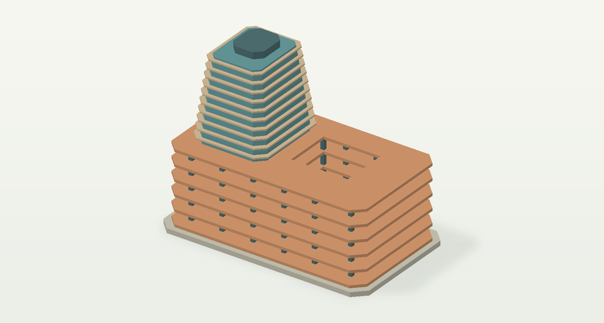
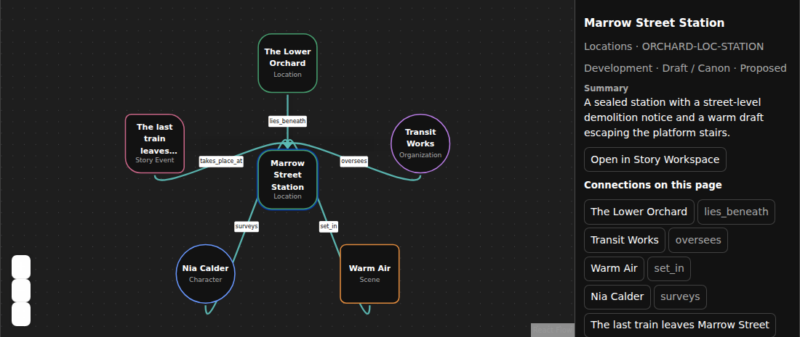

# StoryRoom

StoryRoom is an open-world builder for ChatGPT and Claude. Build a cast, a city, or an account of real events in conversation. The people, places, 3D models, scenes, images, and sources you save belong to the same project. You decide what becomes canon and can open Story Workspace to check exactly what your assistant saved.

A building can have a measured footprint, floors, and rooms. A scene can take place in one of those rooms. If an object moves during a story event, you can inspect its earlier placement and check the evidence for who witnessed the move or when the audience learned about it.

[Homepage](https://storyroom.gorombo.com/) · [Workspace walkthrough](https://storyroom.gorombo.com/workspace/) · [Connect and start](#connect-and-start) · [3D modeling and geography](#3d-modeling-and-geography) · [Worldbuilding tools](#worldbuilding-tools) · [Developer setup](#developer-setup) · [Full tool reference](doc/storyroom-tools.md)

## Connect and start

Hosted access requires a Google account authorized for StoryRoom. The homepage lists current invitation availability. If StoryRoom is already available in your ChatGPT workspace or Claude connectors, connect it there. For a custom connection, use the remote MCP server URL `https://storyroom.gorombo.com/mcp` and select OAuth. Your host must allow custom connections.

| Host | Connect |
| --- | --- |
| **ChatGPT** | In **Plugins**, use the plus button to add a custom MCP server. Name it **StoryRoom**, enter the server URL, choose OAuth with automatic client registration, and create the plugin. Install it, complete sign-in, then start a chat and select StoryRoom using `@`. [OpenAI connection guide](https://developers.openai.com/plugins/deploy/connect-chatgpt) |
| **Claude** | In **Customize → Connectors**, add a custom web connector named **StoryRoom** and enter the server URL. For OAuth client registration, choose **Register automatically**. Add the connector, select **Connect**, and sign in. Enable the connector in the conversation. In a managed organization, an administrator may need to add it first. [Claude connection guide](https://support.claude.com/en/articles/11175166-get-started-with-custom-connectors-using-remote-mcp) |

**First use**

1. Ask **“Open Story Workspace.”** On first use, select **Add project**, give your practice project a title, and select **Create project**. A logline is optional. If you already have projects, select one to resume it or ask the assistant to create a practice project.
2. Try **“Save Marrow Street Station as a location. Save a proposed scene called Warm Air and link it to the station.”**
3. Ask **“Open Warm Air in Story Workspace.”** Under **Relationships**, follow the link to the station. In a later chat, select the same project and ask what happens there.

You can also start from a manuscript, research notes, or an earlier conversation your assistant can access. Give it the material and tell it which details to preserve. A novelist can reuse the world for a screenplay, a game master can pick up an old clue, and a nonfiction author can keep two witnesses’ conflicting accounts attached to their respective sources.

## 3D modeling and geography

| Capability | What you can do |
| --- | --- |
| **Construct geometry** | Draw profiles with holes using lines, circular arcs, and quadratic or cubic Bézier curves. Extrude profiles, loft between cross-sections, create repeated floor slabs, and cut or combine solids with Boolean union, difference, and intersection. Supply indexed surface or solid meshes with normals, UVs, and material properties. |
| **Assemble and move models** | Reuse a versioned asset in multiple places. Translate, rotate, scale, and reparent instances. Choose whether a child moves with its parent or keeps its world position. Record a move at a story event and inspect the earlier placement. |
| **Measure and export** | Inspect vertices and triangles, footprints, floor sections, solid volume, distance, surface clearance, intersection, and containment. Preview a change before saving it. Export exact asset versions and their hierarchy as GLB or zipped glTF for tools such as Blender. |
| **Build terrain** | Define a metre-based XYZ frame with an origin, north bearing, and vertical datum. Place districts, buildings, floors, rooms, and fixed objects. Edit terrain triangles and elevations across patch seams, sample a ground profile, register an aerial to control points, or preview a change of scale or mesh resolution. |
| **Plan and inspect places** | Draw points, routes, rectangles, or polygons. Measure them, drape them over terrain, and review district, corridor, or shoreline boundaries. Inspect the 2D map or orbit the 3D scene, switch display layers, and explore physical, augmented, or historical geometry. Geography flags location descriptions that need review after a boundary change. |

In a project with a saved coordinate frame, try **“Preview a four-by-three-metre rectangular solid, 2.5 metres high. Show me its volume before saving.”** The expected volume is 30 m³. When the preview looks right, ask to save and place the model, then open **Geography → 3D view** to inspect it.



*Synthetic model rendered from StoryRoom’s geometry output. The slabs surround an open atrium, and the tower tapers between its authored cross-sections.*

The Workspace’s **Download GLB** action delivers the selected spatial models when the host supports file saving. Terrain is streamed separately. [Spatial authoring and export](doc/readme/geography-and-modeling.md#build-and-export-a-model) · [Geography controls](doc/readme/geography-and-modeling.md#explore-the-map) · [Terrain and coordinate frames](doc/readme/geography-and-modeling.md#establish-a-coordinate-frame)

## Worldbuilding tools

| Area | What you can do |
| --- | --- |
| **Story development** | Start with a world, a scene, or existing material. Keep a project brief, storytelling methods, a story bible, ideas, decisions, open questions, research, and production notes. Track arcs, plot threads, setups, and payoffs across multiple tellings. |
| **World state and perspective** | The temporal knowledge graph records when facts begin or end. Its reasoning layer uses established event order to answer what was true at a given scene. Compare a character’s belief or perception with objective events and with what the audience has learned. Trace the answer to its evidence. Attendance establishes who was present. A saved observation or account can establish what they saw. An unknown or contradictory order stays unresolved. |
| **Relationship Graph and Timeline** | Browse a record’s links, focus on its neighbors, or inspect a connection in the 2D graph or 3D relationship globe. The Timeline shows event order, unplaced events, participants, and changes. A reveal can reach the audience several scenes after the event it describes. |
| **Search and continuity** | Search exact wording or meaning, read the relevant passage, and follow saved links. Inspect revisions and project activity. Check for conflicting fact intervals, missing approvals, invalid references, and incomplete setups or payoffs. |
| **Images and visual references** | Save supplied or host-generated images, attach profiles to records, and keep exact versions. Link an image to a place, person, or scene. Describe lighting and viewpoint, mark and review a region, search by description, or find images visually similar to a saved reference. |
| **Canon, drafts, and screenplays** | Propose, approve, or reject changes to canon. Save a scene draft, approve its exact version, or revoke approval. Assemble scenes in a fixed order as an archival, working, or approved screenplay. Later edits leave that assembly intact. Export JSON, plain text, or Fountain for Fountain drafts. |



*The Orchard Below* is the fictional project in the walkthrough. Select a graph edge to inspect the recorded relationship, or open a record in Workspace and bring it back into chat. [Watch the walkthrough](https://storyroom.gorombo.com/workspace/).

The [tool reference](doc/storyroom-tools.md) covers all 88 assistant tools, 27 creative record types, 25 supporting record types, and eight additional Workspace actions. For the underlying rules, see [world-state reasoning](doc/readme/story-workflows.md#compare-what-happened-with-who-knew), [search and evidence](doc/readme/story-workflows.md#find-a-record-and-check-its-evidence), [image retrieval](doc/readme/story-workflows.md#work-with-images), and [screenplay assemblies](doc/readme/story-workflows.md#assemble-and-export-a-screenplay).

## Developer setup

### Install and verify a checkout

These instructions require Git access to the private `dansasser/StoryRoom-Source` repository and the [uv package manager](https://docs.astral.sh/uv/getting-started/installation/). The project declares Python 3.12 or later. The commands below were tested with Python 3.14 in a POSIX shell. The quick check exercises the geometry engine, tool contracts, and Workspace in isolation.

```bash
git clone https://github.com/dansasser/StoryRoom-Source.git
cd StoryRoom-Source
uv venv --python 3.14 .venv
uv pip install --python .venv/bin/python -r requirements.lock -r pyproject.toml --extra test
uv venv --python 3.14 .venv-mcp
uv pip install --python .venv-mcp/bin/python -r requirements.mcp.lock

.venv/bin/python -m pytest -q tests/test_spatial_geometry.py
.venv-mcp/bin/python -m pytest -q tests/test_mcp_tools.py tests/test_workspace.py
```

### Run the API and MCP services

A persistent installation needs a dedicated TLS-enabled PostgreSQL database with pgvector, the StoryRoom schema and migrations, an account registry, and credentials for the installation. In your authorized source checkout, open `doc/developer-setup.md` for the database bootstrap, environment settings, and an offline geometry example.

Once provisioned, run each command from the repository root in a separate terminal. Replace the example paths with your private environment files.

```bash
THE_AUGMENT_ENV_FILE=/path/to/api.env \
  .venv/bin/python -m uvicorn augment_api.app:create_app --factory --host 127.0.0.1 --port 8767
```

```bash
THE_AUGMENT_MCP_ENV_FILE=/path/to/mcp.env \
  .venv-mcp/bin/python -m uvicorn augment_mcp.app:create_app --factory --host 127.0.0.1 --port 8768
```

Connect using the installation’s configured credentials. Call `service_status` to inspect API, database, and text-embedding readiness. Then call `describe_story_resources` to verify the story catalog. For hosted ChatGPT and Claude, follow [Connect and start](#connect-and-start).

## Support

You can share the [public StoryRoom documentation](https://github.com/dansasser/StoryRoom#readme) with anyone, including people who haven't signed in.

StoryRoom is maintained by Gorombo. For a reproducible bug or configuration question, use the [public issue tracker](https://github.com/dansasser/StoryRoom/issues). Include the host, the action you took, and the result you expected. Use a fictional example when sharing story records.
